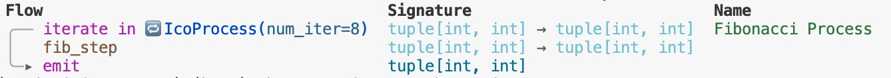
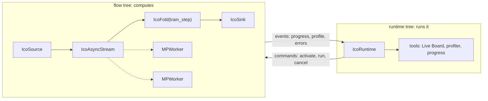
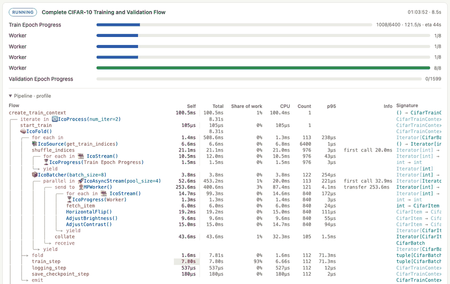
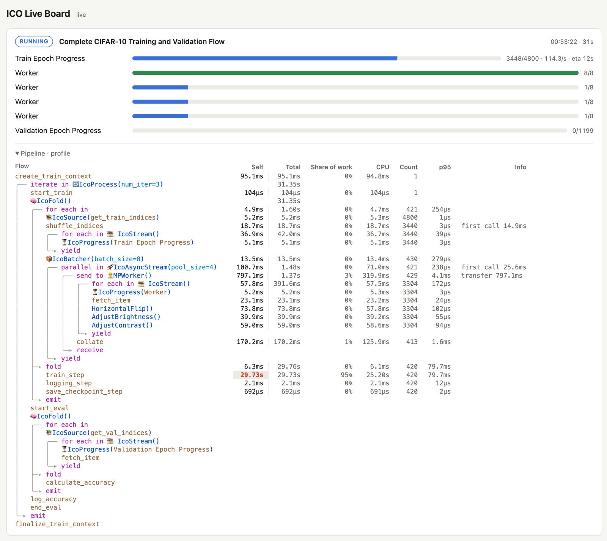

# ICO

[](https://github.com/apriori3d/ico/actions/workflows/ci.yml)

[](https://opensource.org/licenses/Apache-2.0)

ICO (Input → Context → Output) builds computation flows from typed
operators. A flow is a tree that you can describe before it runs, run in
one process, in worker processes or on a cloud GPU, profile, watch in the
browser, and save as JSON. State that changes item by item, such as a model
during training, is data in the flow, not a hidden field.

```python
from ico import IcoProcess, operator

State = tuple[int, int]


@operator()
def fib_step(state: State) -> State:
    a, b = state
    return (b, a + b)


@operator()
def first(state: State) -> int:
    return state[0]


fib8 = IcoProcess(fib_step, num_iterations=8) | first
fib8((0, 1))  # 21
fib8.describe()
```



## How it is built



**Operators.** An `IcoOperator[I, O]` wraps a callable from `I` to `O`.
Signatures are inferred from annotations and generics and checked at every
link: `validate_signatures(flow)` reports mismatches, and mypy or Pylance
check the same types statically.

**Composition.** `a | b` chains operators. A few structural nodes cover the
rest:

| Node | Type | |
| --- | --- | --- |
| `IcoSource`, `IcoSink` | `() → Iterator[O]`, `Iterator[I] → ()` | ends of a flow |
| `op.stream()` | `Iterator[I] → Iterator[O]` | map over items |
| `IcoAsyncStream(factory, pool_size)` | `Iterator[I] → Iterator[O]` | a pool, threads or worker processes |
| `fork`, `route`, `keep`, `partition`, `tap` | | fan out, choose by key, filter, split, side effect |
| `IcoBatcher(n)` | `Iterator[I] → Iterator[Iterator[I]]` | batches |
| `IcoFold(source, step)` | `C → C` | `step((item, state))` for each item: a training epoch |
| `IcoProcess(body, ...)` | `C → C` | repeat `n` times or until a predicate |
| `IcoProgress(total)` | `I → I` | counts the items that pass it |

**Two trees.** The flow tree computes. The runtime tree (`IcoRuntime`)
activates it, sends commands down (activate, run, cancel) and events up
(progress, prints, profiles, errors). Tools attach to the runtime: Rich
progress, the Live Board, the profiler, samples of the results of a node.
A cancelled run stops between items.

**Workers.** `MPWorker(factory)` runs a sub-flow in its own process; inside
an `IcoAsyncStream` it is a pool. Its progress and profile come back to the
main runtime, and the plan shows its flow.

**Specs and the registry.** Operators registered with `register("name", 1)`
are parametric and versioned. `ico.spec.to_spec(flow)` turns a flow into
JSON, and `build(spec)` builds a flow from a spec of registered operators.
Specs take parameters (`{"$param": ...}`) and can refer to other saved
pipelines.

**Remote runs.** `ico.remote` runs a spec as a job in a subprocess or on a
RunPod Serverless GPU. The job carries the operators' code by value, its
inputs go through S3 or a network volume, and its events stream back to the
same tools.

**Assets and resources.** Model weights are pinned assets (`assets.toml`,
`assets.lock`, `ico assets fetch`). Loaded models are resources in a pool
per process, with a RAM budget, shared by the operators that use them.

## Live Board and profiler

```python
from ico import IcoRuntime, LiveBoardTool
from ico.tools.profiler import instrument

board = LiveBoardTool(profile=True)
flow = instrument(flow, board.profiler)
IcoRuntime(flow, tools=[board]).activate().run().deactivate()  # prints the URL
```

The board shows every progress node, worker processes included, the plan
with each node's time, calls and p95, and the models each process holds.
Below, the CIFAR-10 example during training: four `MPWorker`s load and
augment batches, two folds train and validate, and `train_step` takes 95% of
the work.



The whole plan with its profile:



## MCP server

[ico-mcp](https://github.com/apriori3d/ico-mcp) is an MCP server on top of
ICO. An agent finds operators in a domain's registry, composes and validates
specs, runs them locally or on a GPU target and follows them on the Live
Board. It writes new operators as drafts, and once a pipeline works it opens
a pull request that makes them stable.

## Examples

- [ICO basics](src/examples/ico_basics.ipynb) and
  [the runtime](src/examples/ico_runtime_basics.ipynb) (notebooks)
- [Worker processes](src/examples/ico_mp_basic.py) and
  [a pool of them](src/examples/ico_mp_basic_pool.py)
- [Linear regression](src/examples/ml/ico_linear_regression.ipynb)
- CIFAR-10: [notebook](src/examples/ml/cv/cifar/ico_cifar_complete_flow.ipynb),
  [with worker pools](src/examples/ml/cv/cifar/ico_cifar_complete_flow_mp.py)
  (`--epochs 1 --limit 4000 --profile` for a quick run with the profiler)

Worker processes do not run in Jupyter or Colab: run those examples from a
terminal.

## Installation

```bash
pip install git+https://github.com/apriori3d/ico.git
```

or, for development, `poetry install` in a clone.

| Extra | Installs | For |
| --- | --- | --- |
| `remote` | `boto3` | remote runs (S3, RunPod volumes) |
| `vision` | `torch`, `torchvision`, `matplotlib` | the CIFAR-10 examples |
| `examples` | `skrub`, `pydot`, `graphviz` | the skrub examples |
| `notebook` | `ipywidgets` | Rich widgets in Jupyter |

Design notes are in [docs/design](docs/design).

## License

Apache License 2.0, see [LICENSE](LICENSE).
