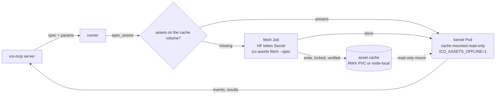

# Proposal: assets and resources

Date: 2026-10-20 (revised the same day: assets and loaded resources). Status: proposal, nothing implemented. Every item of
section 9 is a separate change with its own short design and PR, as
`CLAUDE.md` requires; this document sets the direction.

## 1. Summary

Operators need two things that are not code and not data:

- **files**: model weights, LoRAs, tokenizers, configs, lookup tables.
  Today each operator hard-codes a path such as
  `~/models/wan22/split_files/...` in a constructor default, and someone
  downloads the files by hand beforehand;
- **loaded models**: the objects built from those files, on the CPU or
  the GPU. Today each operator loads them itself, in its own order, and
  keeps them (or not) in a class attribute nobody else sees.

Nothing declares what a pipeline needs, how to get it, how to check it,
or how much memory it takes. The proposal has two layers with two names:

1. An **asset** is a named, pinned, verifiable set of files. A domain
   lists its assets in `assets.toml` (where to get each one: a Hugging
   Face file or snapshot at a fixed revision, or a URL) and a generated
   `assets.lock` (size and sha256 of every file). `asset(id)` returns a
   local path; fetching is an explicit step (`ico assets fetch`), never a
   side effect of a run. Validation reports missing assets before a run.
2. A **resource** is a loaded object (a text encoder, a transformer with
   a fused LoRA in fp8, an OCR engine): a registered, frozen dataclass
   whose fields are JSON params (asset ids, dtypes, LoRAs) and whose
   `load()` builds the object. An operator takes resources as constructor
   params, typed by their class, and **decides the order**:
   `with self.encoder.use("cuda") as te: ...`. A **pool** in the process
   decides **where** a released resource stays (GPU, RAM, nowhere) by its
   key and memory budgets, shares one object between operators with the
   same key, and reports loads in the profile.
3. The remote runner (RunPod, pods) uses the same manifest to prefetch
   assets into a volume, and a long-lived worker keeps its pool between
   jobs, so a model is not loaded again for every job.

## 2. The problem today

Seen in the first domain, `ico-mcp-video`, on one machine (cube: RTX 3090,
62 GB RAM, 1.8 TB disk, Wi-Fi at about 12 MB/s):

- **Paths in defaults.** `wan22_loop` has
  `high = "~/models/wan22/split_files/diffusion_models/wan2.2_i2v_high_noise_14B_fp16.safetensors"`
  and five more like it; `vace_window` and `vace_loop` have three each;
  `diffueraser_generate` points at a checkout with its own venv
  (`~/Projects/Enjoy-videos/tools/DiffuEraser`).
- **Downloads by hand.** Weights came from ad hoc scripts on the machine
  (`~/models/dl.sh`, `dl_wan22.py`, `curl` for Real-ESRGAN). The pipeline
  does not know they exist. 60 GB for Wan2.2 took 1.5 h; 95 GB for LTX-2.3
  took 2 h and was deleted a day later, when nothing used it any more,
  with no record of what else referenced it.
- **No pinning, no checksums.** A repackaged file re-uploaded upstream
  would silently change a pipeline's output on the next download.
- **Hidden dependencies.** Wan2.2 reads its text encoder and VAE from
  `~/models/wan-vace-14b`, downloaded for Wan2.1 VACE; deleting that
  directory breaks Wan2.2. The same VAE file (sha256 `d6e524b3…`) is
  stored twice, under `wan-vace-14b/` and `minimax-remover/`.
- **Late failure.** A missing file is an exception in the middle of a run,
  after the kernel started, often after a large model was half loaded.
  `validate` cannot see it.
- **Crystallization carries machine paths.** A stable operator moved by a
  PR still defaults to `~/models/...` of one machine, with no description
  of where the files come from.
- **Pods.** A kernel started in a pod has none of these files, and a
  multi-gigabyte download inside the kernel would hit the run timeout and
  repeat on every pod.

How the operators of `ico-mcp-video` load models (`video_draft`, read on
2026-10-20):

| Operator | Loading today | Cost |
|---|---|---|
| `wan22_loop` | on every call: UMT5 to the GPU, encode the prompt, drop it, `empty_cache`; then each expert: bf16 → fuse the 4-step LoRA → fp8 storage → leaf-level group offloading; then the VAE to the GPU | the order is the algorithm (it does not fit 24 GB otherwise), but ~70 GB are read and the LoRAs fused again **for every item** |
| `vace_window` | a pipeline cached in a class attribute (`cls._pipe`, keyed by checkpoint, repo, LoRA), CPU offload, `empty_cache` after each window | never released while the process lives ("run it in one worker"); invisible to other operators |
| `detect_scenes_transnet`, `scan_text` | lazy singletons in class attributes | `scan_text` must not share a process with torch: a placement rule known only from its docstring |
| `diffueraser_generate` | an external process with its own venv **per scene** | weights loaded again for every scene |

Where a model is (disk, RAM, GPU) is decided by each operator's code; a
cache, where there is one, hides in a class attribute; neither the plan,
the profile nor another operator can see it.

## 3. Assets: the files

### 3.1 What an asset is

An asset is an id plus a pinned source and the expected content:

- **file**: one file (`.safetensors`, `.pth`, a JSON table);
- **tree**: a set of files under one directory (a Hugging Face snapshot
  subset: `text_encoder/*`, `tokenizer/*`), resolved as the directory.

It is immutable: a new revision or another file is a new id (or the same
id with a new lock, see 3.4). It is read-only for operators.

Not resources (unchanged): Python packages (`pyproject.toml`), binaries
on `PATH` (`bin:<name>` caps), data that flows through a pipeline (inputs,
outputs, intermediate files), secrets (`env` allowlist).

### 3.2 Where files live

One **asset root** per machine or volume, `ICO_ASSETS_ROOT`
(default `~/.cache/ico/assets`). An asset is stored at
`<root>/<path>`, `path` taken from the manifest or the id by default.
Content-addressed storage with deduplication (one copy of the shared VAE)
is an option, section 10, question 3.

```
<root>/
  wan22/high_noise_14B_fp16.safetensors
  wan21-umt5-xxl/text_encoder/model-00001-of-00003.safetensors
  ...
  .ico/partial/<sha256>          downloads in progress
  .ico/locks/<id>.lock           one fetcher per resource
  .ico/verified/<id>.json        size + sha256 + mtime of the last full check
```

### 3.3 Assets and resources

`docs/design/spec.md` plans resources as heavy, process-local *objects*
opened by the runtime. This proposal keeps that word for the objects
(section 4) and calls the files under them assets:

| Layer | What | Declared in | Lifetime |
|---|---|---|---|
| asset | pinned, verified files on disk | `assets.toml` + `assets.lock` | until removed from the root |
| resource | an object loaded from assets (a model on the CPU or GPU) | a registered class in a domain module | in the pool of a process, by key |

"Artifacts" stays the word for run outputs.

### 3.4 `assets.toml` and `assets.lock`

The manifest lives in the domain repository, next to `ico.toml`. People
write `assets.toml`; `ico assets lock` writes `assets.lock`
(as `uv.lock` beside `pyproject.toml`). Both are committed.

```toml
# assets.toml
version = 1

[assets.wan22-i2v-high]
description = "Wan2.2 I2V A14B, high-noise expert, fp16 (ComfyUI repack)"
license = "apache-2.0"
hf = { repo = "Comfy-Org/Wan_2.2_ComfyUI_Repackaged",
       revision = "ee6f4a40737a995bf5818954cfce6d59443b0f04",
       file = "split_files/diffusion_models/wan2.2_i2v_high_noise_14B_fp16.safetensors" }
path = "wan22/high_noise_14B_fp16.safetensors"

[assets.wan21-umt5-xxl]
description = "UMT5-XXL text encoder + tokenizer of Wan2.1 (also used by Wan2.2)"
hf = { repo = "Wan-AI/Wan2.1-VACE-14B-diffusers",
       revision = "db79b90c60bbb45ceec9e41b9d5a4df934538ac4",
       include = ["text_encoder/*", "tokenizer/*"] }

[assets.propainter]
description = "ProPainter weights for DiffuEraser"
url = "https://github.com/sczhou/ProPainter/releases/download/v0.1.0/ProPainter.pth"
sha256 = "12c070c4b48f374c91d8a2a17851140b85c159621080989f9e191bbc18bd6591"
path = "diffueraser/propainter/ProPainter.pth"

[assets.ltx-2.5-distilled]
description = "LTX-2.5 distilled transformer (gated: accept the license on HF)"
hf = { repo = "Lightricks/LTX-2.5", revision = "<sha>",
       file = "diffusion_models/ltx-2.5-22b-distilled-transformer-bf16.safetensors",
       token_env = "HF_TOKEN" }
```

```toml
# assets.lock — generated by `ico assets lock`, do not edit
version = 1

[[asset]]
id = "wan22-i2v-high"
kind = "file"
files = [ { name = "high_noise_14B_fp16.safetensors", size = 28577914792,
            sha256 = "c21c21efa368d529a982a7d89dd11d86608b5937cae9a125d0ffe5491918a100" } ]

[[asset]]
id = "wan21-umt5-xxl"
kind = "tree"
files = [
  { name = "text_encoder/model-00001-of-00003.safetensors", size = 4935812536,
    sha256 = "a8e861969c7433e707cc5a74065d795d36cca07ec96eb6763eb4083df7248f58" },
  # … every file of the subset, configs included
]
```

Rules:

- `hf.revision` is a commit sha, never a branch: `lock` refuses `main`.
- `hf` takes `file` (one file) or `include` (glob patterns, a tree).
- `url` resources give `sha256` in the manifest: there is no metadata API
  to take it from.
- `lock` takes sizes and sha256 from Hugging Face metadata without
  downloading (the LFS object id of a file *is* its sha256: checked on
  cube, `wan2.2_i2v_high_noise_14B_fp16.safetensors` → `c21c21ef…` both in
  the API and by `sha256sum`). Small non-LFS files (configs) are fetched
  and hashed, which costs kilobytes.
- `token_env` names the variable holding a token for gated repositories;
  the token never appears in a file.
- Unknown keys are errors (as in `ico.toml`).

### 3.5 Sizes for people

`ico assets status` (section 5) and every tool that reports resources
show sizes in GB and the estimated download time at a measured or
configured rate, because the size decides whether a fetch is a minute or
an afternoon.

## 4. Resources: loaded models (ICO core)

### 4.1 Assets in code

```python
from ico.assets import asset

asset("wan21-umt5-xxl")        # Path to the tree's directory
```

`asset(id) -> Path` reads the manifest and lock (`ICO_ASSETS_MANIFEST`,
`ICO_ASSETS_ROOT`), checks presence and sizes (no hashing) and returns the
path. Missing or wrong size → `AssetMissing` with the id, the expected
size and the fetch command; it never downloads. Plain stdlib (`pathlib`,
`tomllib`): core keeps its single dependency.

### 4.2 Resource classes

A resource is declared once, as a frozen dataclass in a domain module
(beside the domain types), and used by reference:

```python
# video_draft/models.py
@resource("wan21.umt5", 1)
@dataclass(frozen=True)
class Umt5(Resource[UMT5EncoderModel]):
    """UMT5-XXL text encoder of Wan2.1/2.2 (bf16, ~11 GB)."""
    weights: str = "wan21-umt5-xxl"              # an asset id

    def load(self) -> UMT5EncoderModel:
        return UMT5EncoderModel.from_pretrained(asset(self.weights) / "text_encoder", ...)

@resource("wan22.expert", 1)
@dataclass(frozen=True)
class WanExpert(Resource[WanTransformer3DModel]):
    weights: str
    lora: str = ""
    storage: Literal["bf16", "fp8"] = "fp8"

    def load(self) -> WanTransformer3DModel: ...   # bf16 → fuse LoRA → fp8

UMT5 = Umt5()
WAN22_HIGH = WanExpert("wan22-i2v-high", lora="wan22-lightx2v-i2v-high")
WAN22_LOW = WanExpert("wan22-i2v-low", lora="wan22-lightx2v-i2v-low")
```

- The registered name and version (`"wan21.umt5", 1`) are the stable id
  in specs and saved pipelines; nothing else repeats the string.
- Fields are JSON params; the **key** of a resource is its ref plus its
  fields. Transformations of weights (a fused LoRA, fp8 storage) are
  fields, so a derived model has a key of its own and is built once per
  process.
- `load()` builds the object on the CPU; moving it is the pool's job
  (4.3). A resource may override `size()` (bytes per device) and
  `to(device)` when moving is more than `.to()` (group offloading).
- At registration, string fields named as assets are checked against the
  manifest when it is present, so a typo fails at `propose_operator`, not
  in the middle of a run.

### 4.3 The pool

A pool per process (part of the runtime) holds resources by key across
three tiers: disk (the assets) → RAM → GPU.

- `with res.use("cuda") as model:` takes the resource from the pool, or
  loads it, and moves it to the device; leaving the block **releases** it:
  "not needed on the GPU now", not "destroy".
- Policy (first version): a released resource stays in RAM while the RAM
  budget allows, the least recently used ones are dropped first; the GPU
  holds only what is in use. Budgets come from the environment or
  `ico.toml` (e.g. `ram = "48GB"`).
- Two operators with the same key share one object (UMT5 and the VAE of
  `wan22_loop` and `vace_*`).
- `res.preload()` loads to RAM ahead of time (while the GPU runs the
  previous step); the operator decides when.
- Every load and move is reported to tools: the profile gets a row per
  resource (seconds and bytes per tier, hits), the dashboard shows what is
  in the pool and where.
- The pool lives as long as its process: a run kernel's pool ends with
  the run; a long-lived process (the main kernel of ico-mcp, a RunPod
  worker that runs jobs in process) keeps it between jobs.
- Resources are read-only for operators and never cross into `MPWorker`
  processes; a worker has a pool of its own.

### 4.4 Operators

The operator keeps the order of loading, which is part of its algorithm
for models larger than the GPU:

```python
@register("wan22_loop", 1, tags={"animate", "gpu"})
class Wan22Loop(IcoOperator[LoopPlan, LoopFrames]):
    def __init__(self, encoder: Umt5 = UMT5,
                 high: WanExpert = WAN22_HIGH, low: WanExpert = WAN22_LOW, ...): ...

    def _apply(self, plan: LoopPlan) -> LoopFrames:
        with self.encoder.use("cuda") as te:
            embeds = encode(te, self.prompt)          # then UMT5 goes back to RAM
        with self.high.use("cuda") as hi, self.low.use("cuda") as lo:
            frames = generate(hi, lo, embeds, plan)
        ...
```

- No `resources=` in `register`: the decorator finds the constructor
  params typed by a `Resource` subclass. The card lists them with their
  defaults; a spec gives another variant as
  `{"ref": "wan22.expert@1", "params": {"weights": "wan22-i2v-high", "storage": "bf16"}}`
  and `build` makes the object.
- Defaults are frozen instances, safe as default values; pyright checks
  the type of each resource and `use()` returns the model's type.
- Configuration stays in constructor params (the agent guide's rule).
- Operators that read a small file directly (a lookup table) call
  `asset(id)` with an asset-id param; no resource class is needed.

Not in the first version: process requirements of a resource (`scan_text`
must not share a process with torch; Wan and VACE need a worker of their
own) used to place operators in workers, and resident external processes
as resources (DiffuEraser in its own venv, loaded once, fed scene by
scene). Both are resources with a key and a lifetime and fit the pool
later.

### 4.5 Validation

`ico.spec` gets `spec_assets(spec, params=None)`: the asset ids a spec
needs, from the resource params of its operators (defaults and bound
values) and the asset params of operators that use files directly.

- `validate` in ico-mcp adds a `missing_asset` warning per missing or
  broken asset, with its size, beside `missing_binary`;
- `ico assets status --spec` and the remote runner (section 6) get the
  set to prefetch;
- an asset id not in the manifest is an error at validation.

## 5. Lifecycle

```
  assets.toml ──lock──► assets.lock ──fetch──► <root>/… ──asset()──► operator
   (people)          (sizes, sha256          (download, verify,       (presence +
                      from HF metadata)       atomic rename)            size check)
```

Commands (a small `ico assets` CLI in core; ico-mcp wraps the same
functions as tools):

| Command | Does |
|---|---|
| `lock [ids]` | fills `assets.lock` from the manifest; no large downloads |
| `status [ids \| --spec FILE \| --pipeline NAME]` | per asset: present, missing, partial, corrupt; bytes to fetch; time at the measured rate |
| `fetch [ids \| --spec \| --pipeline] [--dry-run]` | downloads what is missing, verified |
| `verify [ids] [--full]` | sizes, or full sha256 (`--full`); updates `.ico/verified/` |
| `gc [--yes]` | lists files under the root that no lock entry references; deletes only with `--yes` |

Fetch semantics:

- **Atomic.** A file downloads to `.ico/partial/<sha256>`, is hashed while
  it streams, is checked against the lock, `fsync`ed and renamed into
  place. A crash leaves a partial file, never a wrong file at the final
  path.
- **Resumable.** HTTP range requests continue a partial file; the hash of
  the part on disk is recomputed first.
- **Locked.** One fetcher per asset (`fcntl.flock` on
  `.ico/locks/<id>.lock`, which works on local disks and on NFSv4/CephFS):
  a second fetcher, another process or another pod on a shared volume,
  waits and then finds the file present.
- **Checked space.** The free space of the root is compared with the bytes
  to fetch before starting.
- **Plain HTTPS.** Hugging Face files come from
  `https://huggingface.co/<repo>/resolve/<revision>/<file>` (with
  `Authorization` when `token_env` is set); `huggingface_hub` is not
  needed. Faster transfer backends can be an optional extra later.
- **Never implicit.** A run does not fetch. Missing assets fail at
  validation or at `asset()`. In `ico-mcp-video`, downloads of tens of
  gigabytes were started only on the human's word; the tool keeps it that
  way (section 7).
- **Offline.** `ICO_ASSETS_OFFLINE=1` makes `lock` and `fetch` refuse
  network access; status and verify work. Kernel pods run with it set.
- **Verification cost.** A full sha256 of 120 GB takes minutes, so it runs
  after a fetch and on `verify --full`; `asset()` and validation check
  sizes and the `.ico/verified` record (size, mtime, sha256 at check time).

## 6. Remote runner in pods

The runner (planned: kernels started as pods instead of local child
processes; `docs/design/ico-mcp.md` defers "container isolation") needs
three things from this proposal: the asset set of a spec, a fetch that
is safe to run from many pods, and a kernel that never downloads.



- **Asset set first.** Before scheduling, the runner calls
  `spec_assets(spec, params)` (in a small pod or in the server, which
  has the manifest and the cards) and `status` against the cache.
- **Storage.** Two layouts, the same root format:
  - a shared ReadWriteMany volume (NFS, CephFS) mounted at
    `ICO_ASSETS_ROOT` in every pod: one copy per cluster, slower first
    reads of 28 GB files over the network;
  - a node-local cache (local PV or hostPath on NVMe): fast reads, one
    copy per node, filled by the same fetch on that node.
- **Prefetch.** A fetch **Job** per missing set (or an init container in
  the kernel pod for node-local caches) runs `ico assets fetch --spec`.
  It is the only pod with network access to model hubs and the only one
  that mounts the HF token Secret. Locks make concurrent jobs for the same
  asset safe.
- **Kernel pod.** Mounts the cache read-only, runs with
  `ICO_ASSETS_OFFLINE=1`, starts with `verify` (sizes + verified
  records, seconds) and fails fast with `AssetMissing` otherwise. Run
  timeouts then measure the run, not a download.
- **Scheduling on warm nodes.** With node-local caches the runner labels
  nodes with the assets they hold (or keeps an inventory per node from
  `status`) and sets node affinity, so a Wan2.2 run (60 GB) goes to a node
  that already has it. A cold node gets the fetch job first.
- **Progress.** Fetch progress (bytes, rate, ETA per asset) is reported
  like a run's progress: the dashboard shows a fetch as a run of its own,
  and `run` on a pod with a cold cache returns a `fetching` state instead
  of hanging.
- **Images.** Assets are never baked into images (tens of GB, separate
  update cycles); small ones may be, if the lock still describes them.

## 7. ico-mcp

Consumer of the core API; its own small changes:

- The kernel gets `ICO_ASSETS_MANIFEST` and `ICO_ASSETS_ROOT` from
  `ico.toml` (`assets = { root = "~/models" }`), not through the `env`
  allowlist.
- `validate`: `missing_asset` warnings (section 4.5).
- `get_operator`: the operator's resources with their defaults and the
  status of their assets; `list_types` / `get_type` show resource classes
  beside the domain types (they live in the same modules).
- `environment`: the root, its free space, and the status of assets
  matching a filter.
- Tools `assets_status(pipeline | spec | ids)` and
  `fetch_assets(...)`: a fetch is a long job like a run (`wait=false`,
  `wait_run`, dashboard), and the server instructions say to ask the human
  before a fetch that downloads more than a few GB.
- `propose_operator`: a draft with a hard-coded absolute path to a large
  file gets a warning that names `asset()` and resource classes.
- `crystallize` gate: every asset id the moved operators and resource
  classes use exists in `assets.toml` and `assets.lock`; the PR lists
  the assets with sizes. Resource classes move with the operators that
  use them, like types. Files are not downloaded by the gate.

## 8. Migration of ico-mcp-video

Assets on cube on 2026-10-20 (the LTX-2.3 and Real-ESRGAN files were
removed the same day). Sizes and sha256 by `sha256sum` on cube; revisions
from the Hugging Face API.

| Id | Source (revision) | Files | Size | Used by |
|---|---|---|---|---|
| `wan22-i2v-high` | `Comfy-Org/Wan_2.2_ComfyUI_Repackaged` (`ee6f4a40`) | `wan2.2_i2v_high_noise_14B_fp16.safetensors`, sha256 `c21c21ef…` | 28.58 GB | `wan22_loop` |
| `wan22-i2v-low` | same | `wan2.2_i2v_low_noise_14B_fp16.safetensors`, `edb89340…` | 28.58 GB | `wan22_loop` |
| `wan22-lightx2v-i2v-high` | same | `wan2.2_i2v_lightx2v_4steps_lora_v1_high_noise.safetensors`, `d176c808…` | 1.23 GB | `wan22_loop` |
| `wan22-lightx2v-i2v-low` | same | `…_low_noise.safetensors`, `024f21de…` | 1.23 GB | `wan22_loop` |
| `wan22-i2v-configs` | `Wan-AI/Wan2.2-I2V-A14B-Diffusers` (`596658fd`) | `*.json`, `tokenizer/*` | 21 MB | `wan22_loop` |
| `wan21-umt5-xxl` | `Wan-AI/Wan2.1-VACE-14B-diffusers` (`db79b90c`) | `text_encoder/*`, `tokenizer/*` | 11.38 GB | `wan22_loop` (today hidden, via `shared=`), `vace_window`, `vace_loop` |
| `wan21-vae` | same | `vae/*`, `d6e524b3…` | 0.51 GB | `wan22_loop`, `vace_window`, `vace_loop` (also stored again in `minimax-remover/`) |
| `wan21-vace-14b-fp16` | `Comfy-Org/Wan_2.1_ComfyUI_repackaged` (`123acf1c`) | `wan2.1_vace_14B_fp16.safetensors`, `f202a5c5…` | 34.68 GB | `vace_window`, `vace_loop` |
| `lightx2v-t2v-14b-lora` | `Kijai/WanVideo_comfy` (`8260d429`) | `Lightx2v/lightx2v_T2V_14B_cfg_step_distill_v2_lora_rank32_bf16.safetensors`, `78a7f815…` | 0.32 GB | `vace_window`, `vace_loop` |
| `diffueraser` | `lixiaowen/diffuEraser` (`ad510dca`) | `brushnet/*` (3.54 GB), `unet_main/*` (5.25 GB) | 8.80 GB | `diffueraser_generate` |
| `diffueraser-pcm` | to confirm | `pcm_sd15_smallcfg_2step_converted.safetensors`, `4c5f27a7…` | 0.13 GB | `diffueraser_generate` |
| `propainter` | GitHub release of ProPainter (to confirm) | `ProPainter.pth`, `raft-things.pth`, `recurrent_flow_completion.pth` | 0.20 GB | `diffueraser_generate` |
| `sd15-text-encoder` | `stable-diffusion-v1-5` (to confirm) | `text_encoder/*`, `tokenizer/*`, configs | 0.49 GB | `diffueraser_generate` |
| `sd-vae-ft-mse` | `stabilityai/sd-vae-ft-mse` (to confirm) | `diffusion_pytorch_model.safetensors`, `a1d99348…`; `vae-ft-mse-840000-ema-pruned.safetensors`, `735e4c3a…` | 0.67 GB | `diffueraser_generate` |
| `minimax-remover` | `zibojia/minimax-remover` (`889e4165`) | `transformer/*` (2.25 GB) + VAE | 2.76 GB | none: candidate for removal |

Total in use: about 117 GB; 0.5 GB of it duplicated (the VAE).

Not assets, unchanged:

- PaddleOCR models: downloaded by PaddleX itself to `~/.paddlex` (22 MB).
  They could become assets later with `PADDLE_PDX_MODEL_SOURCE`
  pointed at the root; not worth it at this size.
- TransNetV2 weights: inside the `transnetv2-pytorch` wheel.
- The DiffuEraser checkout and its venv
  (`~/Projects/Enjoy-videos/tools/DiffuEraser/.venv`): code and an
  environment, not files; its weights become the assets above and its
  `weights/` symlinks are generated from `asset()` paths. A pinned
  external tool (git revision + lockfile) is section 10, open question 4.

Steps, one PR each, after the core items:

1. `assets.toml` with the table above; `ico assets lock`; check that
   `verify --full` passes on cube against the existing files (they are
   already in place: no download).
2. Move the files to the root layout with `ico assets adopt` (section
   9, item 3) or keep `root = "~/models"` with today's paths in `path`.
3. Resource classes in `video_draft/models.py` (UMT5, Wan VAE, Wan
   experts, VACE, TransNet, OCR); operators take them as params:
   `wan22_loop` first (its `shared` param becomes `encoder` + `vae`;
   measure the time per item before and after), then `vace_*`, then the
   rest. DiffuEraser keeps its external process until item 9.

## 9. Plan of work

| | Item | Repo | Size |
|---|---|---|---|
| 1 | `assets.toml` / `assets.lock` formats, `asset(id)`, `AssetMissing` | ico | S |
| 2 | `ico assets lock / status / verify / fetch` (stdlib HTTPS, locks, atomic, resume, offline) | ico | M |
| 3 | `adopt` (register files already on disk after a full hash) and `gc` (listing first) | ico | S |
| 4 | Resources: `@resource`, `Resource[T]`, the pool (`use`, release, keys, RAM budget, LRU), resource params in cards and specs, profile rows | ico | M |
| 5 | `spec_assets(spec, params)` through resources | ico | S |
| 6 | Kernel env, `validate` warnings, `get_operator`, `environment`; `assets_status`, `fetch_assets` as jobs; crystallize gate | ico-mcp | M |
| 7 | ico-mcp-video: `assets.toml` (section 8), then `wan22_loop` (measure time per item before and after), `vace_*`, `transnet` / `scan_text` | ico-mcp-video | M |
| 8 | A pool across jobs: the RunPod worker runs jobs in process; prefetch to the volume | ico | M |
| 9 | Later: process requirements of resources; resident external processes (DiffuEraser) | ico | M |

Items 1–2 remove hard-coded paths and late failures; 4 removes the hidden
model loading.

## 10. Decisions and open questions

Decided on 2026-10-20:

- Two words: **assets** for files, **resources** for loaded objects.
- The operator decides the order of loading; the pool decides where a
  released resource stays. No region node (`using`) and no `resources`
  section in specs: a resource is a constructor param, shared by key.
- Resources are frozen dataclasses declared once in a domain module and
  referenced as Python objects; strings only as registered names and
  asset ids.
- Pool policy: RAM budget plus least recently used, nothing finer until a
  real need.
- Weight transformations (LoRA, fp8) are fields of a resource, not
  separate derived resources.
- No disk cache of derived weights (a fused fp8 expert) until the cost of
  building them is measured.
- Contexts (`IcoContextOperator`, `C` flowing through a chain) are for
  mutable run state (training); resources are not contexts.

Open:

1. **Lock file or hashes in the manifest.** A separate generated
   `assets.lock` keeps the manifest short (one tree asset has dozens of
   files); hashes inline are one file fewer.
2. **Content-addressed root.** Storing files by sha256 with a link per
   path removes duplicates (the Wan VAE) and makes `gc` trivial, but
   makes the root harder to read by eye and needs hard links or symlinks
   on every volume type the runner uses.
3. **Root per domain or per machine.** A shared root lets two domains
   reuse the same Wan files; ids would then need a namespace
   (`video/wan22-i2v-high`) or a global id space.
4. **Pinned tools.** DiffuEraser is a git checkout with its own venv:
   an asset kind ("a repository at a revision plus a lockfile") or the
   runner's images?
5. **Auto-fetch for development.** No, until a real need appears.
