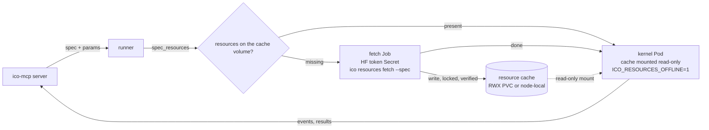

# Proposal: pipeline resources

Date: 2026-10-20. Status: proposal, nothing implemented. Every item of
section 9 is a separate change with its own short design and PR, as
`CLAUDE.md` requires; this document sets the direction.

## 1. Summary

Operators need files that are not code: model weights, LoRAs, tokenizers,
configs, lookup tables. Today each operator hard-codes a path such as
`~/models/wan22/split_files/...` in a constructor default, and someone
downloads the files by hand beforehand. Nothing declares what a pipeline
needs, how to get it or how to check it.

The proposal:

1. A **resource** is a named, pinned, verifiable set of files. A domain
   lists its resources in `resources.toml` (where to get each one: a
   Hugging Face file or snapshot at a fixed revision, or a URL) and a
   generated `resources.lock` (size and sha256 of every file).
2. An operator **declares** the resources it uses in `register(...)` and
   **resolves** them at run time with `resource(id)`, which returns a
   local path. No path is hard-coded.
3. Validation reports missing or broken resources before a run starts,
   like `bin:<name>` capabilities report missing binaries today.
4. Fetching is an **explicit step** (`ico resources fetch`), never a side
   effect of a run: downloads are atomic, locked, verified by sha256, and
   can run offline-checked.
5. The remote runner that starts kernels in pods uses the same manifest:
   it computes the resource set of a spec, prefetches it into a shared
   cache volume with a fetch job, mounts the cache read-only in the kernel
   pod and prefers nodes whose cache is already warm.

The word "resource" is already used in `docs/design/spec.md`, "Direction:
resources and contexts", for process-local objects opened by the runtime
(`{"$res": "train_ds"}`). Section 3.3 joins the two: the stored files of
this proposal are what such an opened resource is loaded from.

## 2. The problem today

Seen in the first domain, `ico-mcp-video`, on one machine (cube: RTX 3090,
62 GB RAM, 1.8 TB disk, Wi-Fi at about 12 MB/s):

- **Paths in defaults.** `wan22_loop` has
  `high = "~/models/wan22/split_files/diffusion_models/wan2.2_i2v_high_noise_14B_fp16.safetensors"`
  and five more like it; `vace_window` and `vace_loop` have three each;
  `diffueraser_generate` points at a checkout with its own venv
  (`~/Projects/Enjoy-videos/tools/DiffuEraser`).
- **Downloads by hand.** Weights came from ad hoc scripts on the machine
  (`~/models/dl.sh`, `dl_wan22.py`, `curl` for Real-ESRGAN). The pipeline
  does not know they exist. 60 GB for Wan2.2 took 1.5 h; 95 GB for LTX-2.3
  took 2 h and was deleted a day later, when nothing used it any more,
  with no record of what else referenced it.
- **No pinning, no checksums.** A repackaged file re-uploaded upstream
  would silently change a pipeline's output on the next download.
- **Hidden dependencies.** Wan2.2 reads its text encoder and VAE from
  `~/models/wan-vace-14b`, downloaded for Wan2.1 VACE; deleting that
  directory breaks Wan2.2. The same VAE file (sha256 `d6e524b3…`) is
  stored twice, under `wan-vace-14b/` and `minimax-remover/`.
- **Late failure.** A missing file is an exception in the middle of a run,
  after the kernel started, often after a large model was half loaded.
  `validate` cannot see it.
- **Crystallization carries machine paths.** A stable operator moved by a
  PR still defaults to `~/models/...` of one machine, with no description
  of where the files come from.
- **Pods.** A kernel started in a pod has none of these files, and a
  multi-gigabyte download inside the kernel would hit the run timeout and
  repeat on every pod.

## 3. The resource model

### 3.1 What a resource is

A resource is an id plus a pinned source and the expected content:

- **file**: one file (`.safetensors`, `.pth`, a JSON table);
- **tree**: a set of files under one directory (a Hugging Face snapshot
  subset: `text_encoder/*`, `tokenizer/*`), resolved as the directory.

It is immutable: a new revision or another file is a new id (or the same
id with a new lock, see 3.4). It is read-only for operators.

Not resources (unchanged): Python packages (`pyproject.toml`), binaries
on `PATH` (`bin:<name>` caps), data that flows through a pipeline (inputs,
outputs, intermediate files), secrets (`env` allowlist).

### 3.2 Where files live

One **resource root** per machine or volume, `ICO_RESOURCES_ROOT`
(default `~/.cache/ico/resources`). A resource is stored at
`<root>/<path>`, `path` taken from the manifest or the id by default.
Content-addressed storage with deduplication (one copy of the shared VAE)
is an option, section 10, question 3.

```
<root>/
  wan22/high_noise_14B_fp16.safetensors
  wan21-umt5-xxl/text_encoder/model-00001-of-00003.safetensors
  ...
  .ico/partial/<sha256>          downloads in progress
  .ico/locks/<id>.lock           one fetcher per resource
  .ico/verified/<id>.json        size + sha256 + mtime of the last full check
```

### 3.3 Relation to opened resources (spec.md)

`docs/design/spec.md` plans resources as heavy, process-local *objects*
(a dataset, a device, an HTTP client) opened by the runtime with a
`scope`. This proposal covers the layer under them: the *files* they are
opened from. One word, two layers:

| Layer | What | Declared in | Lifetime |
|---|---|---|---|
| stored resource (this proposal) | pinned, verified files on disk | `resources.toml` + `resources.lock` | until removed from the root |
| opened resource (spec.md, later) | an object loaded from stored resources | spec `resources` section, `{"$res": ...}` | `run`, `process`, `server` |

When opened resources are implemented, a model resource class takes
stored resource ids as params (`{"weights": "wan22-i2v-high"}`), so a
loaded Wan2.2 pipeline could be shared across operators of a run. Nothing
here depends on that.

### 3.4 `resources.toml` and `resources.lock`

The manifest lives in the domain repository, next to `ico.toml`. People
write `resources.toml`; `ico resources lock` writes `resources.lock`
(as `uv.lock` beside `pyproject.toml`). Both are committed.

```toml
# resources.toml
version = 1

[resources.wan22-i2v-high]
description = "Wan2.2 I2V A14B, high-noise expert, fp16 (ComfyUI repack)"
license = "apache-2.0"
hf = { repo = "Comfy-Org/Wan_2.2_ComfyUI_Repackaged",
       revision = "ee6f4a40737a995bf5818954cfce6d59443b0f04",
       file = "split_files/diffusion_models/wan2.2_i2v_high_noise_14B_fp16.safetensors" }
path = "wan22/high_noise_14B_fp16.safetensors"

[resources.wan21-umt5-xxl]
description = "UMT5-XXL text encoder + tokenizer of Wan2.1 (also used by Wan2.2)"
hf = { repo = "Wan-AI/Wan2.1-VACE-14B-diffusers",
       revision = "db79b90c60bbb45ceec9e41b9d5a4df934538ac4",
       include = ["text_encoder/*", "tokenizer/*"] }

[resources.propainter]
description = "ProPainter weights for DiffuEraser"
url = "https://github.com/sczhou/ProPainter/releases/download/v0.1.0/ProPainter.pth"
sha256 = "12c070c4b48f374c91d8a2a17851140b85c159621080989f9e191bbc18bd6591"
path = "diffueraser/propainter/ProPainter.pth"

[resources.ltx-2.5-distilled]
description = "LTX-2.5 distilled transformer (gated: accept the license on HF)"
hf = { repo = "Lightricks/LTX-2.5", revision = "<sha>",
       file = "diffusion_models/ltx-2.5-22b-distilled-transformer-bf16.safetensors",
       token_env = "HF_TOKEN" }
```

```toml
# resources.lock — generated by `ico resources lock`, do not edit
version = 1

[[resource]]
id = "wan22-i2v-high"
kind = "file"
files = [ { name = "high_noise_14B_fp16.safetensors", size = 28577914792,
            sha256 = "c21c21efa368d529a982a7d89dd11d86608b5937cae9a125d0ffe5491918a100" } ]

[[resource]]
id = "wan21-umt5-xxl"
kind = "tree"
files = [
  { name = "text_encoder/model-00001-of-00003.safetensors", size = 4935812536,
    sha256 = "a8e861969c7433e707cc5a74065d795d36cca07ec96eb6763eb4083df7248f58" },
  # … every file of the subset, configs included
]
```

Rules:

- `hf.revision` is a commit sha, never a branch: `lock` refuses `main`.
- `hf` takes `file` (one file) or `include` (glob patterns, a tree).
- `url` resources give `sha256` in the manifest: there is no metadata API
  to take it from.
- `lock` takes sizes and sha256 from Hugging Face metadata without
  downloading (the LFS object id of a file *is* its sha256: checked on
  cube, `wan2.2_i2v_high_noise_14B_fp16.safetensors` → `c21c21ef…` both in
  the API and by `sha256sum`). Small non-LFS files (configs) are fetched
  and hashed, which costs kilobytes.
- `token_env` names the variable holding a token for gated repositories;
  the token never appears in a file.
- Unknown keys are errors (as in `ico.toml`).

### 3.5 Sizes for people

`ico resources status` (section 5) and every tool that reports resources
show sizes in GB and the estimated download time at a measured or
configured rate, because the size decides whether a fetch is a minute or
an afternoon.

## 4. Operator API (ICO core)

### 4.1 Declaring

Configuration stays in constructor params (the rule of the agent guide):
an operator that uses a resource takes its **id** as a param, so a spec
can pick another variant, and declares which params are resource ids:

```python
@register(
    "wan22_loop", 1,
    tags={"animate", "gpu"},
    resources={"high": "wan22-i2v-high", "low": "wan22-i2v-low",
               "lora_high": "wan22-lightx2v-i2v-high",
               "lora_low": "wan22-lightx2v-i2v-low",
               "text_encoder": "wan21-umt5-xxl", "vae": "wan21-vae",
               "configs": "wan22-i2v-configs"},
)
class Wan22Loop(IcoOperator[LoopPlan, LoopFrames]):
    def __init__(self, ..., high: str = "wan22-i2v-high", ...) -> None:
        ...
```

- `resources` maps a constructor param to its default resource id; the
  param's default must equal it (checked at registration).
- The card gains `resources` (param → id). `get_operator` shows them with
  their status on this machine.
- An operator whose resource is not configurable still takes the param:
  one mechanism, and the spec records what was used.

### 4.2 Resolving

```python
from ico.resources import resource

def _load(self) -> None:
    high = resource(self.high)              # Path to the file
    shared = resource(self.text_encoder)    # Path to the tree's directory
```

- `resource(id) -> Path` reads the manifest and lock (paths from
  `ICO_RESOURCES_MANIFEST`, `ICO_RESOURCES_ROOT`), checks presence and
  sizes (cheap: no hashing), and returns the path.
- Missing or wrong size → `ResourceMissing` with the id, the expected
  size and the fetch command; it never downloads.
- `resource()` is plain stdlib (`pathlib`, `tomllib`): core keeps its
  single dependency (`rich`).

### 4.3 Validation

`ico.spec` gets `spec_resources(spec, params=None)`: the resource ids a
spec needs, from the cards of its operators and the bound values of their
resource params. Uses:

- `validate` in ico-mcp adds a `missing_resource` warning per missing or
  broken resource, with its size, beside `missing_binary`;
- `ico resources status --spec` and the remote runner (section 6) get the
  set to prefetch;
- a value of a resource param that is not in the manifest is an error at
  validation: a typo fails before any download or run.

## 5. Lifecycle

```
  resources.toml ──lock──► resources.lock ──fetch──► <root>/… ──resource()──► operator
   (people)          (sizes, sha256          (download, verify,       (presence +
                      from HF metadata)       atomic rename)            size check)
```

Commands (a small `ico resources` CLI in core; ico-mcp wraps the same
functions as tools):

| Command | Does |
|---|---|
| `lock [ids]` | fills `resources.lock` from the manifest; no large downloads |
| `status [ids \| --spec FILE \| --pipeline NAME]` | per resource: present, missing, partial, corrupt; bytes to fetch; time at the measured rate |
| `fetch [ids \| --spec \| --pipeline] [--dry-run]` | downloads what is missing, verified |
| `verify [ids] [--full]` | sizes, or full sha256 (`--full`); updates `.ico/verified/` |
| `gc [--yes]` | lists files under the root that no lock entry references; deletes only with `--yes` |

Fetch semantics:

- **Atomic.** A file downloads to `.ico/partial/<sha256>`, is hashed while
  it streams, is checked against the lock, `fsync`ed and renamed into
  place. A crash leaves a partial file, never a wrong file at the final
  path.
- **Resumable.** HTTP range requests continue a partial file; the hash of
  the part on disk is recomputed first.
- **Locked.** One fetcher per resource (`fcntl.flock` on
  `.ico/locks/<id>.lock`, which works on local disks and on NFSv4/CephFS):
  a second fetcher, another process or another pod on a shared volume,
  waits and then finds the file present.
- **Checked space.** The free space of the root is compared with the bytes
  to fetch before starting.
- **Plain HTTPS.** Hugging Face files come from
  `https://huggingface.co/<repo>/resolve/<revision>/<file>` (with
  `Authorization` when `token_env` is set); `huggingface_hub` is not
  needed. Faster transfer backends can be an optional extra later.
- **Never implicit.** A run does not fetch. Missing resources fail at
  validation or at `resource()`. In `ico-mcp-video`, downloads of tens of
  gigabytes were started only on the human's word; the tool keeps it that
  way (section 7).
- **Offline.** `ICO_RESOURCES_OFFLINE=1` makes `lock` and `fetch` refuse
  network access; status and verify work. Kernel pods run with it set.
- **Verification cost.** A full sha256 of 120 GB takes minutes, so it runs
  after a fetch and on `verify --full`; `resource()` and validation check
  sizes and the `.ico/verified` record (size, mtime, sha256 at check time).

## 6. Remote runner in pods

The runner (planned: kernels started as pods instead of local child
processes; `docs/design/ico-mcp.md` defers "container isolation") needs
three things from this proposal: the resource set of a spec, a fetch that
is safe to run from many pods, and a kernel that never downloads.



- **Resource set first.** Before scheduling, the runner calls
  `spec_resources(spec, params)` (in a small pod or in the server, which
  has the manifest and the cards) and `status` against the cache.
- **Storage.** Two layouts, the same root format:
  - a shared ReadWriteMany volume (NFS, CephFS) mounted at
    `ICO_RESOURCES_ROOT` in every pod: one copy per cluster, slower first
    reads of 28 GB files over the network;
  - a node-local cache (local PV or hostPath on NVMe): fast reads, one
    copy per node, filled by the same fetch on that node.
- **Prefetch.** A fetch **Job** per missing set (or an init container in
  the kernel pod for node-local caches) runs `ico resources fetch --spec`.
  It is the only pod with network access to model hubs and the only one
  that mounts the HF token Secret. Locks make concurrent jobs for the same
  resource safe.
- **Kernel pod.** Mounts the cache read-only, runs with
  `ICO_RESOURCES_OFFLINE=1`, starts with `verify` (sizes + verified
  records, seconds) and fails fast with `ResourceMissing` otherwise. Run
  timeouts then measure the run, not a download.
- **Scheduling on warm nodes.** With node-local caches the runner labels
  nodes with the resources they hold (or keeps an inventory per node from
  `status`) and sets node affinity, so a Wan2.2 run (60 GB) goes to a node
  that already has it. A cold node gets the fetch job first.
- **Progress.** Fetch progress (bytes, rate, ETA per resource) is reported
  like a run's progress: the dashboard shows a fetch as a run of its own,
  and `run` on a pod with a cold cache returns a `fetching` state instead
  of hanging.
- **Images.** Resources are never baked into images (tens of GB, separate
  update cycles); small ones may be, if the lock still describes them.

## 7. ico-mcp

Consumer of the core API; its own small changes:

- The kernel gets `ICO_RESOURCES_MANIFEST` and `ICO_RESOURCES_ROOT` from
  `ico.toml` (`resources = { root = "~/models" }`), not through the `env`
  allowlist.
- `validate`: `missing_resource` warnings (section 4.3).
- `get_operator`: the operator's resources with their status.
- `environment`: the root, its free space, and the status of resources
  matching a filter.
- Tools `resources_status(pipeline | spec | ids)` and
  `fetch_resources(...)`: a fetch is a long job like a run (`wait=false`,
  `wait_run`, dashboard), and the server instructions say to ask the human
  before a fetch that downloads more than a few GB.
- `propose_operator`: a draft with a hard-coded absolute path to a large
  file gets a warning that names `resources=`.
- `crystallize` gate: every resource id a moved operator declares exists
  in `resources.toml` and `resources.lock`; the PR lists the resources
  with sizes. Files are not downloaded by the gate.

## 8. Migration of ico-mcp-video

Resources on cube on 2026-10-20 (the LTX-2.3 and Real-ESRGAN files were
removed the same day). Sizes and sha256 by `sha256sum` on cube; revisions
from the Hugging Face API.

| Id | Source (revision) | Files | Size | Used by |
|---|---|---|---|---|
| `wan22-i2v-high` | `Comfy-Org/Wan_2.2_ComfyUI_Repackaged` (`ee6f4a40`) | `wan2.2_i2v_high_noise_14B_fp16.safetensors`, sha256 `c21c21ef…` | 28.58 GB | `wan22_loop` |
| `wan22-i2v-low` | same | `wan2.2_i2v_low_noise_14B_fp16.safetensors`, `edb89340…` | 28.58 GB | `wan22_loop` |
| `wan22-lightx2v-i2v-high` | same | `wan2.2_i2v_lightx2v_4steps_lora_v1_high_noise.safetensors`, `d176c808…` | 1.23 GB | `wan22_loop` |
| `wan22-lightx2v-i2v-low` | same | `…_low_noise.safetensors`, `024f21de…` | 1.23 GB | `wan22_loop` |
| `wan22-i2v-configs` | `Wan-AI/Wan2.2-I2V-A14B-Diffusers` (`596658fd`) | `*.json`, `tokenizer/*` | 21 MB | `wan22_loop` |
| `wan21-umt5-xxl` | `Wan-AI/Wan2.1-VACE-14B-diffusers` (`db79b90c`) | `text_encoder/*`, `tokenizer/*` | 11.38 GB | `wan22_loop` (today hidden, via `shared=`), `vace_window`, `vace_loop` |
| `wan21-vae` | same | `vae/*`, `d6e524b3…` | 0.51 GB | `wan22_loop`, `vace_window`, `vace_loop` (also stored again in `minimax-remover/`) |
| `wan21-vace-14b-fp16` | `Comfy-Org/Wan_2.1_ComfyUI_repackaged` (`123acf1c`) | `wan2.1_vace_14B_fp16.safetensors`, `f202a5c5…` | 34.68 GB | `vace_window`, `vace_loop` |
| `lightx2v-t2v-14b-lora` | `Kijai/WanVideo_comfy` (`8260d429`) | `Lightx2v/lightx2v_T2V_14B_cfg_step_distill_v2_lora_rank32_bf16.safetensors`, `78a7f815…` | 0.32 GB | `vace_window`, `vace_loop` |
| `diffueraser` | `lixiaowen/diffuEraser` (`ad510dca`) | `brushnet/*` (3.54 GB), `unet_main/*` (5.25 GB) | 8.80 GB | `diffueraser_generate` |
| `diffueraser-pcm` | to confirm | `pcm_sd15_smallcfg_2step_converted.safetensors`, `4c5f27a7…` | 0.13 GB | `diffueraser_generate` |
| `propainter` | GitHub release of ProPainter (to confirm) | `ProPainter.pth`, `raft-things.pth`, `recurrent_flow_completion.pth` | 0.20 GB | `diffueraser_generate` |
| `sd15-text-encoder` | `stable-diffusion-v1-5` (to confirm) | `text_encoder/*`, `tokenizer/*`, configs | 0.49 GB | `diffueraser_generate` |
| `sd-vae-ft-mse` | `stabilityai/sd-vae-ft-mse` (to confirm) | `diffusion_pytorch_model.safetensors`, `a1d99348…`; `vae-ft-mse-840000-ema-pruned.safetensors`, `735e4c3a…` | 0.67 GB | `diffueraser_generate` |
| `minimax-remover` | `zibojia/minimax-remover` (`889e4165`) | `transformer/*` (2.25 GB) + VAE | 2.76 GB | none: candidate for removal |

Total in use: about 117 GB; 0.5 GB of it duplicated (the VAE).

Not resources, unchanged:

- PaddleOCR models: downloaded by PaddleX itself to `~/.paddlex` (22 MB).
  They could become resources later with `PADDLE_PDX_MODEL_SOURCE`
  pointed at the root; not worth it at this size.
- TransNetV2 weights: inside the `transnetv2-pytorch` wheel.
- The DiffuEraser checkout and its venv
  (`~/Projects/Enjoy-videos/tools/DiffuEraser/.venv`): code and an
  environment, not files; its weights become the resources above and its
  `weights/` symlinks are generated from `resource()` paths. A pinned
  external tool (git revision + lockfile) is section 10, question 5.

Steps, one PR each, after the core items:

1. `resources.toml` with the table above; `ico resources lock`; check that
   `verify --full` passes on cube against the existing files (they are
   already in place: no download).
2. Move the files to the root layout with `ico resources adopt` (section
   9, item 4) or keep `root = "~/models"` with today's paths in `path`.
3. Operators take resource ids: `wan22_loop` first (its `shared` param
   becomes `text_encoder` + `vae`), then `vace_*`, then DiffuEraser.

## 9. Plan of work

| | Item | Repo | Size |
|---|---|---|---|
| 1 | Manifest and lock formats, `resource()`, `ResourceMissing`, `register(resources=)`, card field | ico | S |
| 2 | `spec_resources(spec, params)` | ico | S |
| 3 | `ico resources lock / status / verify / fetch` (stdlib HTTPS, locks, atomic, resume, offline) | ico | M |
| 4 | `adopt` (register files already on disk after a full hash) and `gc` (listing first) | ico | S |
| 5 | Kernel env, `validate` warnings, `get_operator`, `environment` | ico-mcp | S |
| 6 | `resources_status`, `fetch_resources` as jobs; instructions; crystallize gate | ico-mcp | M |
| 7 | ico-mcp-video migration (section 8) | ico-mcp-video | M |
| 8 | Runner integration: fetch Job, read-only mount, offline kernel, warm-node affinity | runner | M |

Items 1–3 are the minimum that removes hard-coded paths and late
failures; 8 waits for the runner.

## 10. Open questions

1. **One word or two.** This proposal uses "resource" for stored files and
   keeps spec.md's opened objects as a second layer of the same word
   (3.3). The alternative is another word for the files ("assets",
   "artifacts"); "artifacts" is already used for run outputs in
   ico-mcp's deferred items.
2. **Lock file or hashes in the manifest.** A separate generated
   `resources.lock` keeps the manifest short (one tree resource has
   dozens of files); hashes inline are one file fewer.
3. **Content-addressed root.** Storing files by sha256 with a link per
   path removes duplicates (the Wan VAE) and makes `gc` trivial, but
   makes the root harder to read by eye and needs hard links or symlinks
   on every volume type the runner uses.
4. **Root per domain or per machine.** A shared root lets two domains
   reuse the same Wan files; ids would then need a namespace
   (`video/wan22-i2v-high`) or a global id space.
5. **Pinned tools.** DiffuEraser is a git checkout with its own venv.
   Should a resource kind cover "a repository at a revision plus a
   lockfile, installed into a venv", or does that belong to the runner's
   images?
6. **Auto-fetch for development.** A flag that lets `resource()` fetch on
   a developer machine would save a step for small files, at the cost of
   the "never implicit" rule; proposed: no, until a real need appears.
